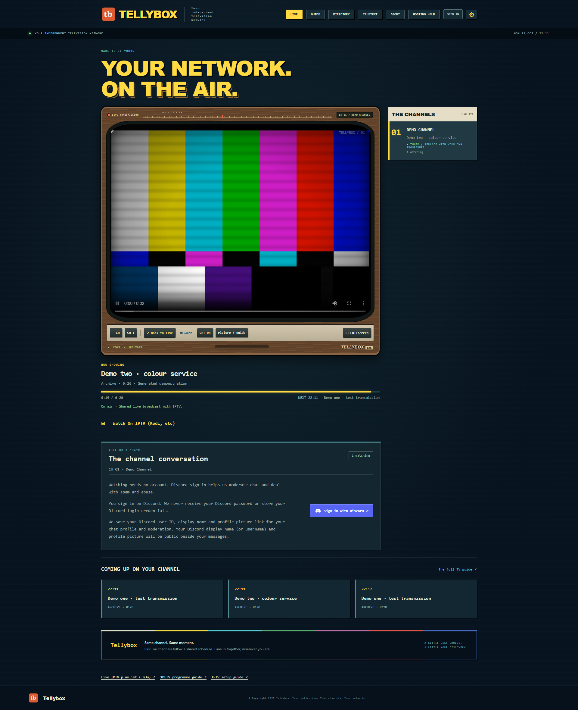
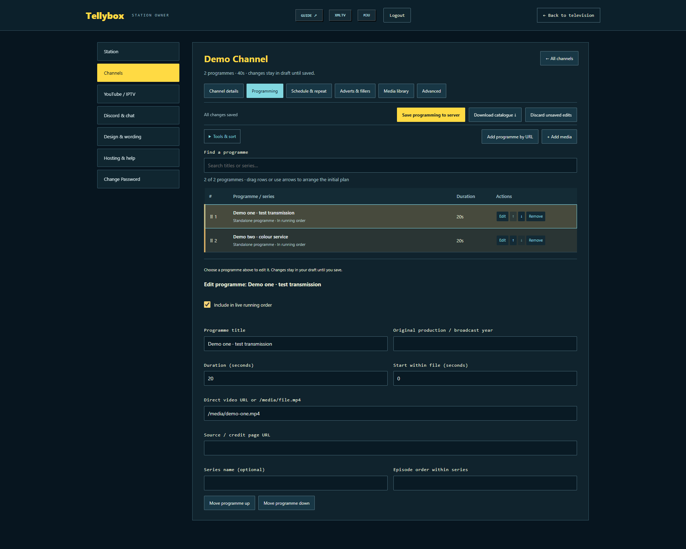
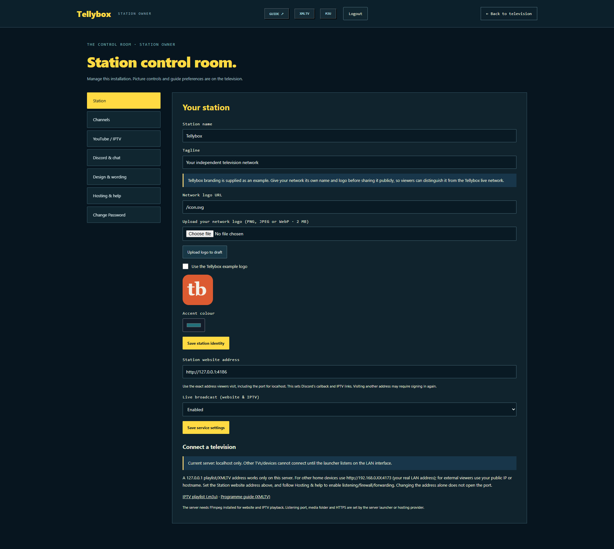

<p align="center"></p>
<h1 align="center">Tellybox</h1>
<h3 align="center">Your collection. Your channels. Your television station.</h3>
<p align="center">Build an always-on television network with shared live broadcasts, a proper TV guide and a retro television interface.</p>

<p align="center">
<a href="https://github.com/BryanWalker321/Tellybox/actions/workflows/ci.yml"></a>
<a href="https://github.com/BryanWalker321/Tellybox/releases"></a>
<a href="https://nodejs.org/"></a>
<a href="compose.yaml"></a>
<a href="LICENSE"></a>
<a href="https://discord.gg/WeTsEbdcCZ"></a>
<a href="https://ko-fi.com/tellybox"></a>
</p>

<p align="center"><a href="https://telly-box.uk">Website</a> · <a href="#quick-start">Quick start</a> · <a href="docs/HOSTING.md">Setup guide</a> · <a href="docs/SCHEDULING.md">Scheduling</a> · <a href="https://discord.gg/WeTsEbdcCZ">Discord</a> · <a href="https://ko-fi.com/tellybox">Ko-fi</a></p>



## What is Tellybox?

Turn your media into your own linear television channels. Everyone tunes into the same running programme: website and IPTV viewers receive the same live HLS broadcast, allowing for normal buffering. Manage programmes, channels and branding in a dedicated browser-based control room. Viewers can watch without an account.

The self-hosted edition starts with **one channel and two short demo transmissions**. Add your own programming and identity. The hosted station's curated collection, promotional homepage and Tip buttons are excluded. The community/support links in this README belong to the Tellybox project; your own station can use its own Discord invite.

## Features

| Station management | Scheduling | Viewing |
|---|---|---|
| Custom name, logo, colours and wording | Listed, random or episodic order | Shared live web player |
| Full-page owner control room | Automatic repeats or fresh reshuffles | M3U playlist and XMLTV guide |
| Local uploads and folder browser | Back-to-back playback or timed breaks | Desktop and mobile layouts |
| Searchable media and filler libraries | Clock-aligned starts and previews | Directory and Teletext |
| Guided setup and connection checks | Adverts, fillers and intervals | Optional Discord sign-in/discussion |

The starter permits custom content, including recent productions. Online providers can restrict playback; check sources from your own server before scheduling them.

## Quick start

### Docker Compose (recommended)

Install [Docker Desktop](https://www.docker.com/products/docker-desktop/) on Windows/macOS, or Docker Engine with the Compose plugin on Linux. Docker includes Node.js, FFmpeg and the optional provider tools.

1. Download/extract the starter ZIP from [Releases](https://github.com/BryanWalker321/Tellybox/releases/latest), or clone it:

   ```sh
   git clone https://github.com/BryanWalker321/Tellybox.git
   cd Tellybox
   ```

2. Open a terminal in the extracted/cloned folder and run:

   ```sh
   docker compose up -d --build
   docker compose logs --tail=30 tellybox
   ```

3. Open **http://127.0.0.1:4173** on the server computer. Open the **settings cog**, enter the first-run setup key shown in the log and choose an owner password of at least 12 characters. An unclaimed server prints a new key after restarting.
4. Set your name/logo in **Station**. In **Channels**, open the demo channel's programming, replace the demos and save. Configure adverts/fillers if wanted, or use back-to-back playback.
5. Run **Hosting & help → Guided station setup**. Choose home-only, sharing from home or VPS hosting, then follow its connection checks. Set your own Discord invite, or leave it blank to hide the icon.

The default port mapping accepts connections only from the server computer. Follow the [hosting guide](docs/HOSTING.md) for LAN access, home servers, DuckDNS, custom domains, VPS and HTTPS. Public DNS points to your public IP, never a private `192.168...` address. DuckDNS does not provide port forwarding or bypass CGNAT.

### Without Docker

Install **Node.js 22.13+** and **FFmpeg**, with `ffmpeg` and `ffprobe` on PATH. Extract the starter or clone it, then run `npm start`. Open **http://127.0.0.1:4173**, claim the station using its printed key and follow steps 4–5 above. No npm dependency installation is needed. Keep the server running. See [Providers](docs/PROVIDERS.md) for optional YouTube/Dailymotion tools and [Hosting](docs/HOSTING.md) for automatic startup.

## The control room

Search programmes, import server folders, reuse station media and preview the running order before saving.





Screenshots show the self-hosted demo. Click an image to see its original desktop resolution.

## Documentation

| Guide | Covers |
|---|---|
| [Hosting](docs/HOSTING.md) | Windows/Linux, LAN, home/VPS, domains, DuckDNS, HTTPS and firewalls |
| [Owner setup](docs/OWNER_SETUP.md) | Claiming the station, passwords and settings |
| [Scheduling](docs/SCHEDULING.md) | Episodes, repeats, reshuffles, adverts, fillers and imports |
| [Customising](docs/CUSTOMISING.md) | Branding, layout, wording and holding screens |
| [Discord](docs/DISCORD.md) | Your invite, optional sign-in and discussion |
| [Providers](docs/PROVIDERS.md) | Online sources and playback checks |
| [IPTV](docs/IPTV_RELIABILITY.md) | Live feeds and troubleshooting |
| [Teletext](docs/TELETEXT.md) | Pages and navigation |
| [Testing](docs/TESTING.md) | Automated checks and release validation |

For Kodi/IPTV, use your reachable station address plus `/channels.m3u` for the playlist and `/guide.xml` for XMLTV. No Discord account is needed for TV/IPTV.

## Updates and backups

Back up station data and media before updating. Docker stores them in the `community-data` and `media-data` volumes; native installs use `data/` and `media/`. Keep owner settings, databases and sessions private.

For Git installs, stop the station, back up, run `git pull --ff-only`, then `docker compose up -d --build`. ZIP users should extract a new release separately and retain existing data/media. Do not use `docker compose down -v` for updates: it deletes persistent volumes.

## Community and support

<p align="center"></p>
<h3 align="center"><a href="https://discord.gg/WeTsEbdcCZ">Join the Tellybox community</a></h3>
<p align="center">Setup help · Share your station · Bug reports · Suggestions</p>

Watch at [telly-box.uk](https://telly-box.uk). Support development and hosting on [Ko-fi](https://ko-fi.com/tellybox).

## Contributing and licence

See [Contributing](CONTRIBUTING.md). Original code uses the [MIT licence](LICENSE); demo transmissions are CC0. Third-party material retains its own terms, including the BBC-associated Test Card F image: see [Third-party notices](THIRD_PARTY_NOTICES.md). Programme media is not supplied; use media you have permission to show.
